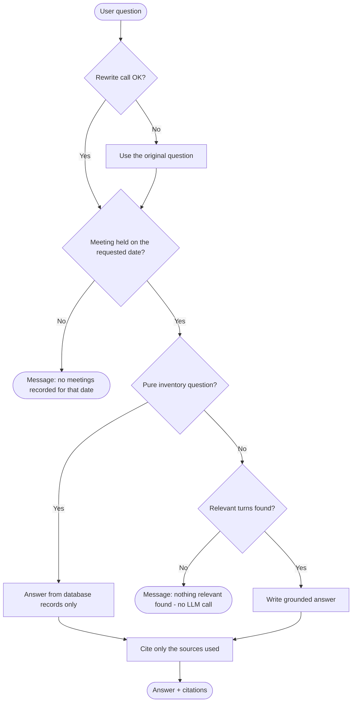
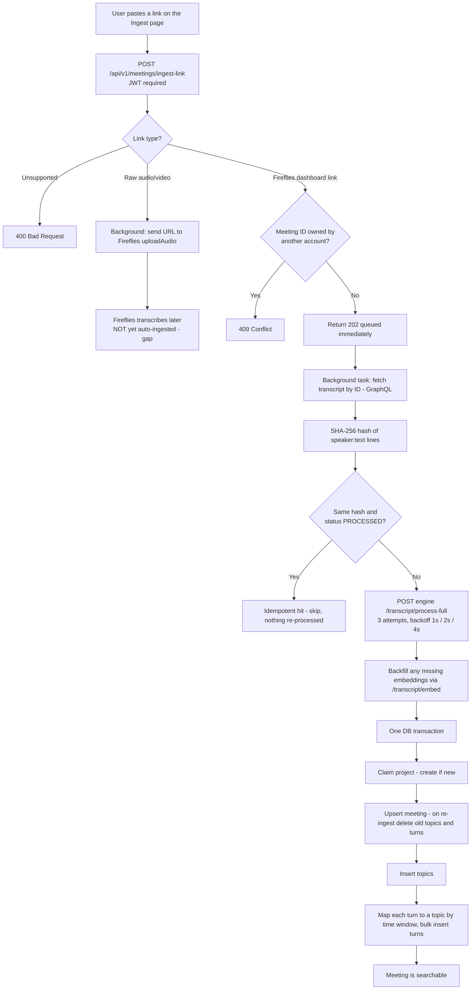
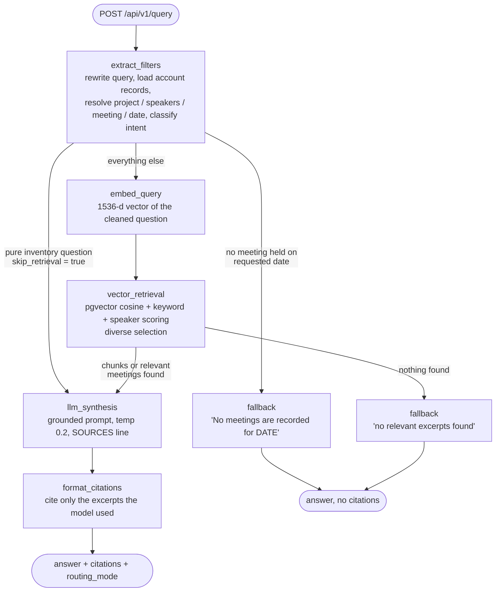
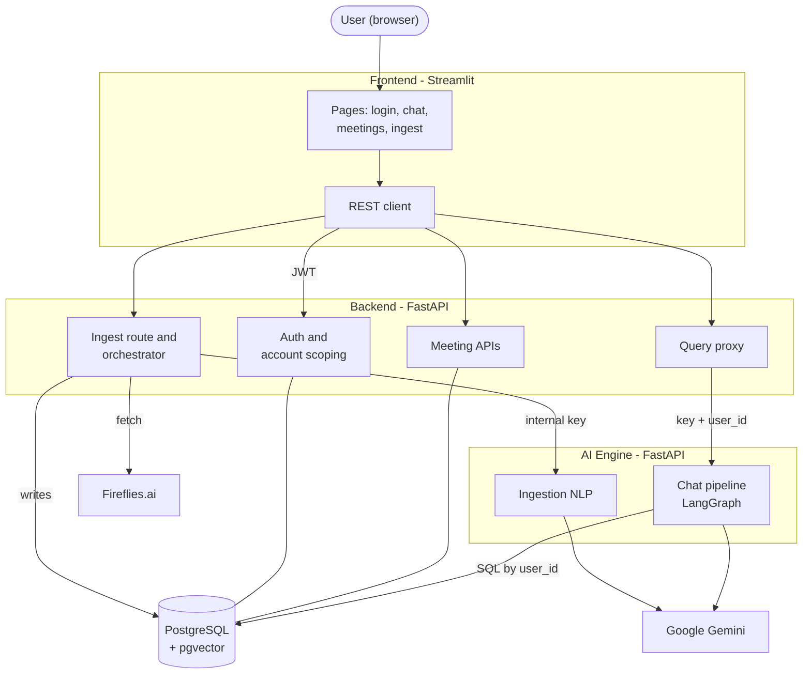
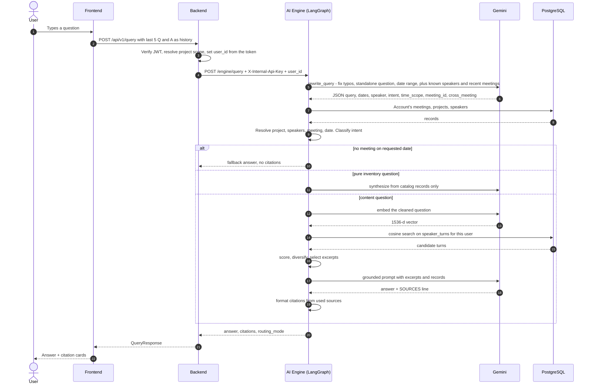
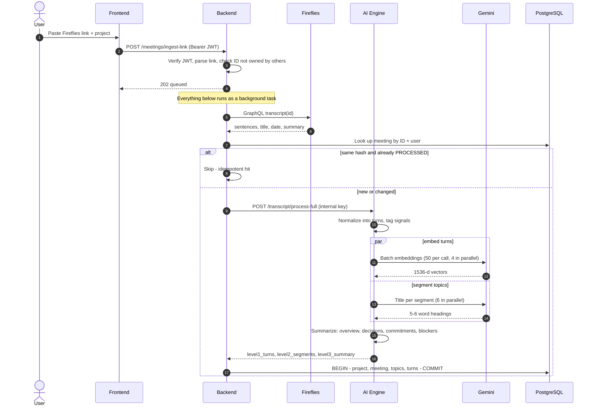

> **Document Type:** Engineering Overview (work in progress)
**Audience:** Reporting manager, engineering leads
**Scope:** System overview: purpose, design, implementation, what is achieved, and what remains
> 

---

## Table of Contents

1. What Is the Platform
2. Why It Is Required
3. Business Layer
4. Conceptual Layer
5. Physical Layer
6. Progress and Roadmap

---

## 1. What Is the Platform

The Meeting Transcript Intelligence Platform turns recorded meetings into a **knowledge base anyone on the team can question in plain English**. A user pastes a Fireflies transcript link; the system fetches, structures and stores it. The user then asks questions in a chat and gets a short answer with citations to the exact speaker and moment.

**In one sentence:** every recorded meeting becomes queryable, with answers grounded in what was actually said and traceable to the source.

**Status:** the core loop (sign in, ingest, ask, cited answer) works end to end. The project is still in progress; section 6 lists what is done and what remains.

---

## 2. Why It Is Required

| Challenge | Without the platform | With the platform |
| --- | --- | --- |
| Finding a decision or commitment | Scrub through recordings or long transcripts | Ask one question, get the answer and its source |
| "Which meetings did X attend?" | Check calendars and notes by hand | Answered directly from the database |
| Questions across several meetings | Reread and compare each one | Evidence drawn from every relevant meeting |
| Trusting an AI answer | No way to check the source | Every answer cites speaker, time and a quote |
| Shared tool, private data | Risk of seeing others' meetings | Strict per-account isolation |

### Trade-offs and Cons

- **Cost:** a content question uses two LLM calls (query rewrite, answer) and one embedding call. The answer prompt now always carries the last 5 exchanges and, for inventory questions, the full meeting list. Negligible now; the lines to watch at scale.
- **Latency:** about 6.4 s per answer on average in the last benchmark run (2026-10-08), which predates the always-on history and the larger rewrite prompt; re-measure.
- **Transcript quality:** wrong speaker labels or mis-heard words in Fireflies carry straight into answers.
- **Heuristic retrieval:** ranking uses hand-tuned weights, not a trained reranker, and scans all in-scope turns (no SQL top-k), so it will not scale as-is.
- **Accuracy not yet measured:** the 50-question benchmark returned an answer for 49, which measures availability, not correctness. A manual read shows some wrong answers.
- **Prompt sensitivity:** routing and answers depend on LLM prompts, so model or prompt changes need regression testing.

---

## 3. Business Layer

### 3.1 Who Uses It

One role: **a signed-in team member**. Each account ingests and queries its own meetings; accounts never see each other's data, even with the same project name. There is no admin workflow yet.

### 3.2 Input and Output

- **Input:** a Fireflies dashboard link (plus optional project and title). The system reads each utterance (speaker, text, start/end time), the title, date, duration and Fireflies' summary. Raw audio links are forwarded to Fireflies but not yet auto-ingested afterwards.
- **Output:** a short grounded answer, **citations** (speaker, time range, 280-character snippet per turn, or one entry per meeting when searching across meetings), and how the question was interpreted (project, speaker, meeting, date).

### 3.3 Failure Handling

The platform prefers an honest "I could not find that" over a made-up answer.

At ingestion, an unsupported link returns 400, a meeting ID owned by another account returns 409, the engine call is retried 3 times with backoff, and the database write is one transaction so a failure leaves no half-loaded meeting. If background ingestion still fails, the meeting is saved with status `FAILED` and a user-safe reason (for example Fireflies rejected the key, transcript not found, rate limit), and the Meetings page lists it as failed instead of the failure being silent.

### 3.4 What Has Been Achieved

Account isolation, link-based ingestion with safe re-ingestion, inventory answers (counts and lists), participant questions, content questions (facts, decisions, commitments, summaries), meeting and date awareness, follow-up questions, cross-meeting questions, source citations, refusing to guess, and a 50-question evaluation harness. Example queries for each are in section 6.1.

---

## 4. Conceptual Layer

### 4.1 Two Pipelines, One Shared Store

The **Ingestion Pipeline** runs once per meeting and turns a transcript into structured, embedded data. The **Query Pipeline** runs on every question: it understands the question, retrieves evidence, and writes a cited answer. Both share one PostgreSQL + pgvector database; the query side never changes stored data.

Every account owns its data through a `users` table, and each meeting is stored in four tiers, each a coarser view of the one below:

| Tier | Table | Holds | Used in answering today? |
| --- | --- | --- | --- |
| Owner | `users` | Email and bcrypt password hash; every table below carries a `user_id` pointing here | Yes, for login and isolation |
| 1 | `projects` | Project grouping, per account | Yes, for filtering and inventory answers |
| 2 | `meetings` | Title, date, summary, content hash | Yes, for dates, scoping and inventory answers |
| 3 | `meeting_topics` | 5 to 6 word topic headings | Stored, **not yet searched** |
| 4 | `speaker_turns` | Speaker, text, times, signal flags, 1536-d embedding | **Yes, this is what retrieval searches** |

IDs are deterministic (`mtg_<id>_turn_007`), so every statement traces back to a turn, which is what makes citations possible.

### 4.2 Pipeline 1: Ingestion

1. **Intake:** the link is parsed and the route returns **HTTP 202** immediately; the rest runs as a background task.
2. **Fetch and idempotency:** the transcript is pulled from Fireflies and a SHA-256 hash of its `speaker:text` lines is compared with the stored one. Unchanged means skip; changed means rebuild in place.
3. **Process in the AI engine** (3 attempts, 1 s / 2 s / 4 s backoff):

| Step | What it does |
| --- | --- |
| Normalize | Merge consecutive sentences by the same speaker into **turns**, with deterministic IDs |
| Tag signals | Regex flags for question, commitment, blocker |
| Embed *(parallel)* | 1536-d Gemini embeddings of `[time] Speaker: text`, in batches of 50 |
| Segment *(parallel)* | Group turns into topics by word-overlap similarity between neighbouring windows (2 to 10 turns per topic); an LLM writes a 5 to 6 word heading |
| Summarize | Overview, decisions, commitments, blockers, each tied to its source turn. Items are extracted by rules from the turns, so no turn ID can be invented; the LLM only writes the short overview, and only when Fireflies supplied no summary |

4. **Persist atomically:** one transaction claims the project, upserts the meeting, inserts topics, and bulk-inserts turns (each attached to a topic by time window). Any failure rolls everything back.

If an LLM is unavailable, topic headings and the overview fall back to heuristics or a template. If embeddings fail, placeholder vectors are used, which are not semantically meaningful, so retrieval quality drops.

### 4.3 Pipeline 2: Query Processing

A **LangGraph** state graph with three exits: normal retrieval, a database-only shortcut for pure inventory questions, and a fallback that never calls the answer LLM.

**Layer 1, Understand the question.** One small LLM call fixes typos, makes follow-ups standalone and returns structured fields: date range, speaker, intent, `time_scope` (`latest` or `earliest`), `cross_meeting` (search all meetings, no single-meeting lock) and `meeting_id`. For `meeting_id` the model sees the account's 50 most recent meetings (id, title, date, oldest to newest), so titles and ordinal references ("the second call") resolve there, and the returned ID is validated against the account's records. The system then resolves the project, people (full name or fuzzy match) and meeting using only this account's records, in this order: UI selection, the model's `meeting_id`, date, title or ID match in the query text, then `time_scope` (newest or oldest meeting, also per participant). It classifies the intent:
- **Catalog:** counts and lists of projects, meetings, participants.
- **Participant involvement:** which meetings a person attended.
- **Content Q&A:** everything else, answered by retrieval.

Dates are handled in code: one meeting on a date scopes to it, several are searched together, none returns a clear "no meetings recorded" message.

**Layer 2, Retrieve.** The question is embedded and one SQL query pulls this account's turns, filtered by meeting, date, project and speaker. Each turn is scored: 3 x vector similarity, + 1.5 per query keyword found, + 3.5 if the speaker is the person named, - 2 for filler such as "ok". Across several meetings, selection forces diversity so one meeting cannot dominate. If a speaker filter returns nothing, the search repeats without it.

**Layer 3, Synthesize.** The prompt holds numbered excerpts (meeting, held-on date, speaker, time, quote), database records with counts already computed in code, the recent chat history (always included, last 5 question and answer pairs) and today's date. For inventory questions, inferred scope or no scope, the records list every available meeting in date order, so "first" and "last" are grounded in the full timeline; an explicit single-meeting question gets only that meeting. Inventory questions are never treated as locked to the selected meeting. Rules: 2 to 5 sentences, use only the supplied context and say so when information is missing, never show internal IDs, and end with a `SOURCES` line.

**Layer 4, Cite.** Because the model reports which excerpts it used, exactly those are cited. Greetings and database-only answers show none. With one meeting in scope the user gets turn-level cards; otherwise one card per meeting.

### 4.4 Safeguards

Independent layers, so if one fails the others still hold: login gate (valid JWT), internal key (the engine accepts only the backend), account scope (every SQL filtered by `user_id`), grounded prompt, and a source filter that cites only what the answer used.

---

## 5. Physical Layer

### 5.1 Technology Stack

| Component | Technology | Role |
| --- | --- | --- |
| Frontend | Streamlit | Login, chat with citations, meeting browser, ingest form |
| Backend API | FastAPI | Auth, account scoping, Fireflies fetch, ingestion orchestration, query proxy |
| AI Engine | FastAPI + LangGraph | Ingestion NLP and the chat pipeline; internal key only |
| LLM / Embeddings | Gemini 2.5 Flash / Gemini Embedding 001 (1536-d) | Rewrite, synthesis, topic headings / vectors |
| Database | PostgreSQL + pgvector | Relational tiers, HNSW cosine index, full-text column (not yet used) |
| Auth | bcrypt + JWT (HS256) | Password hashing and sessions |
| Transcripts | Fireflies.ai (GraphQL) | Source of meetings |
| Evaluation | DeepEval | 50-question benchmark |

### 5.2 System Architecture: Overview

The frontend only calls the backend. The backend has no AI logic: its query route adds the authenticated `user_id` and a shared internal key and passes the request on. All language processing, embeddings and retrieval live in the AI engine, which can be scaled or replaced independently.

**Isolation:** `user_id` is on every table and in every engine query; the backend takes it from the verified token, never from the request body; project IDs are stored as `user:name`; and automated tests confirm that naming another account's meeting, project or speaker returns nothing.

### 5.3 System Architecture: Query Processing

### 5.4 System Architecture: Document Ingestion

---

## 6. Progress and Roadmap

### 6.1 What Has Been Achieved, with Example Queries

Run each query in the Assistant and paste the screenshot under it. Example data: project NOLOCODE, 8 meetings, April to October 2026.

#### Per-user isolation
Each account sees only its own data, enforced in every query and covered by automated tests.
**Query** (as a second account): `How many meetings are there?`
> 📷 *paste screenshot here*

#### Safe, repeatable ingestion
**Try:** submit the same Fireflies link twice on the Ingest page; the second run is skipped by its content hash.
> 📷 *paste screenshot here*

#### Database-grounded inventory answers
Counts and lists come from SQL and are computed in code; pure inventory questions skip vector search. Typos are tolerated.
**Queries:** `How many meetings are there under the NOLOCODE project?` / `how many meeitngs are there?`
> 📷 *paste screenshot here*

#### Participant involvement
**Query:** `Which meetings did Karan Middha attend?`
> 📷 *paste screenshot here*

#### Facts, commitments and rationale
Semantic search narrowed to a person and meeting.
**Queries:**
- `What AWS EC2 instance type did parteek chaurasiya specify in the M4 and DevOps discussion?`
- `What did Neha commit to doing before finalizing the PDF report generation in the Nolocode meeting?`
- `Why did Ashpreet Singh recommend using multiple S3 buckets for document processing instead of a single bucket?`

> 📷 *paste screenshot here*

#### Meeting scoping and summaries
**Queries:**
- `In meeting 01KQBRC3M5TCY9WDC7SQVV3X6F, how many charts did Neha say must be shown for Cash Flow and Runway?`
- `Summarize the key topics and infrastructure decisions from the M4 And Devops Discussion.`

> 📷 *paste screenshot here*

#### Relative time and dates
"Last meeting" resolves to the newest meeting and "first meeting" to the oldest (also per participant); a date with no meeting gets a clear answer without calling the LLM.
**Queries:** `What happened in the latest call?` / `What was discussed in the first meeting?` / `What was discussed on June 12?` / `What happened on June 13?`
> 📷 *paste screenshot here*

#### Follow-up questions
**Queries (same chat):** `Who attended the S3 meeting?` then `What did Ashpreet say about buckets?`
> 📷 *paste screenshot here*

#### Cross-meeting synthesis
**Query:** `Across all meetings, what AWS services and infrastructure components were discussed by the team?`
> 📷 *paste screenshot here*

#### Refusing to guess
**Queries:** `What discount percentage was negotiated for our Snowflake data warehouse subscription?` / `What did Satya Nadella say during the Akili X Sfs standup meeting?`
> 📷 *paste screenshot here*

#### Source citations
Every content answer carries citation cards (speaker, time, snippet) for the excerpts actually used. Expand the citations under any answer above.
> 📷 *paste screenshot here*

### 6.2 Current Status

| Area | State | Detail |
| --- | --- | --- |
| Auth, isolation, ingestion, chat, citations | **Done** | Automated tests cover isolation, inventory routing, history and dates |
| Topics and summary tiers | **Partial** | Built but not used by retrieval; decisions, commitments, blockers are computed then dropped; only the overview text is saved |
| Retrieval quality | **Partial** | Hand-tuned scoring, no reranker, no SQL top-k; full-text index unused |
| Evaluation | **Partial** | Harness runs; no correctness metrics yet |
| Raw audio, webhooks, job status | **Partial** | Audio only forwarded to Fireflies; no webhooks or job-status endpoint. Failed ingestions are now recorded as `FAILED` meetings with a reason, but there is no retry queue |
| Deployment and tests | **Partial** | Unit and integration tests exist in all three services (engine: isolation, catalog routing, temporal resolution, history; backend: API and auth isolation; frontend: auth and pages). No docker-compose, no end-to-end tests or CI |

### 6.3 Next Steps, in Priority Order

1. **Measure correctness** on the benchmark for a real baseline.
2. **Upgrade retrieval:** top-k in SQL, hybrid vector plus full-text search, reranker.
3. **Use topics and summaries;** persist and expose decisions and action items.
4. **Webhook-driven ingestion** with job status; auto-ingest uploaded audio.
5. **Production readiness:** docker-compose, end-to-end tests and CI, secrets and CORS hardening.

> No effort estimates are included yet; they can be added per step once priorities are agreed.

---

*Document version: 1.3 | Date: 2026-10-20*
